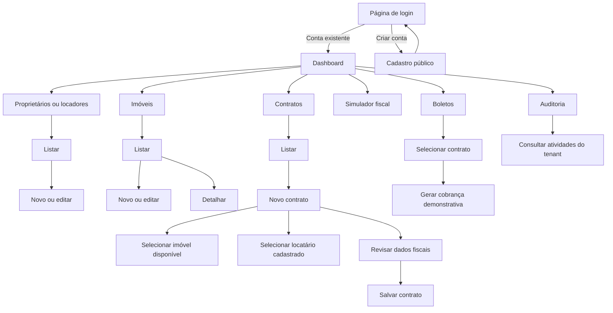

# Fluxo de navegação e protótipo do ImobFiscal

A aplicação publicada funciona como protótipo navegável de alta fidelidade. O fluxo abaixo representa
a versão atual e destaca as evoluções planejadas para locatários e imóveis disponíveis.

## Inventário das telas

| Tela | Objetivo | Ação principal | Situação |
|---|---|---|---|
| Login | Autenticar usuário | Entrar | Implementada |
| Criar conta | Criar tenant e administrador | Cadastrar | Implementada |
| Dashboard | Orientar e resumir o sistema | Novo imóvel | Implementada |
| Imóveis | Consultar patrimônio | Novo imóvel | Implementada |
| Formulário do imóvel | Registrar endereço e características | Salvar | Implementada |
| Locadores | Consultar proprietários da versão atual | Novo locador | Implementada, requer revisão terminológica |
| Contratos | Consultar locações | Novo contrato | Implementada |
| Formulário do contrato | Registrar locação e locatário | Criar contrato | Implementada, evolução planejada |
| Simulador | Explicar cálculo acadêmico | Calcular IBS/CBS | Implementada |
| Boletos | Consultar e gerar cobrança simulada | Gerar boleto | Implementada |
| Auditoria | Consultar atividades | Atualizar | Implementada |

## Princípios observados no protótipo

- Menu lateral persistente com item ativo;
- Breadcrumbs nas telas internas;
- Ações principais posicionadas junto ao título;
- Agrupamento semântico dos formulários;
- Campos obrigatórios identificados;
- Indicadores de carregamento e mensagens de erro;
- Tabelas dentro de contêiner responsivo;
- Botões e links com altura adequada no menu;
- Cores e componentes consistentes.

## Limitações do protótipo

- Menu móvel reduzido a ícones sem rótulos visíveis;
- Não há cadastro reutilizável de locatários;
- Contrato permite digitação manual do locatário;
- Imóveis ocupados ainda podem aparecer na seleção;
- Termos locador, proprietário e locatário exigem explicação;
- Não existe etapa final de revisão do contrato;
- Parte das exclusões usa confirmação nativa do navegador;
- Ausência de recuperação de senha.
